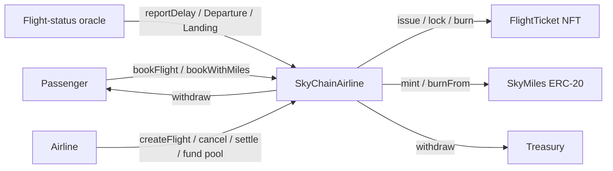
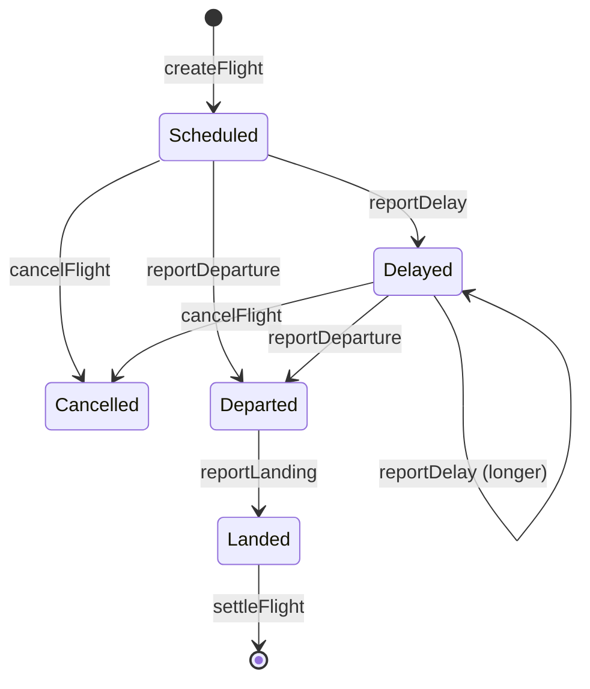

# SkyChain — airline booking on Ethereum

A full dApp for an airline: flights are published on-chain, every seat is an
NFT, fares are held in escrow, refunds follow a coded policy, delays pay out
automatically, and flying earns an ERC-20 loyalty token.

Stack: Solidity 0.8.28, OpenZeppelin 5, Hardhat 2, ethers 6, MetaMask.

## Contracts

| Contract | Standard | Role |
|---|---|---|
| `SkyChainAirline.sol` | AccessControl, Pausable, ReentrancyGuard | Booking engine: flights, escrow, refunds, check-in, oracle reports, compensation, settlement |
| `FlightTicket.sol` | ERC-721 + Enumerable | One NFT per seat. Resellable until check-in, then locked (non-transferable boarding pass). Metadata and SVG image generated fully on-chain |
| `SkyMiles.sol` | ERC-20 + Burnable + Permit (EIP-2612) | Loyalty token. Minted only by the booking engine, burned to buy award seats |



### Roles

| Role | Held by (deploy script) | Can |
|---|---|---|
| `DEFAULT_ADMIN_ROLE` | account #0 | grant/revoke roles, change treasury |
| `AIRLINE_ROLE` | account #0 | publish, cancel and settle flights |
| `PAUSER_ROLE` | account #0 | pause new bookings and check-ins (circuit breaker) |
| `ORACLE_ROLE` | account #1 | report delays, departure, landing |
| `MINTER_ROLE` on SkyMiles | the airline contract | mint miles |
| `ISSUER_ROLE` on FlightTicket | the airline contract | issue, lock, burn tickets |

Account #2 is the treasury that receives airline revenue. Use accounts #3 and up as passengers.

### Flight lifecycle



### Business rules coded in the contract

| Situation | Outcome |
|---|---|
| Passenger cancels 7+ days before departure | 100 % refund |
| Passenger cancels 48 h to 7 days before | 50 % refund, 50 % to the airline treasury |
| Passenger cancels within 48 h | no refund |
| Award ticket cancelled | same percentages, refunded in miles (re-minted) |
| Check-in | opens 48 h, closes 1 h before the *effective* departure (scheduled + delay) |
| Check-in done | ticket NFT locked, no more resale or cancellation |
| Delay of 3 h or more, passenger checked in | 50 % of the fare from the compensation pool + bonus miles, claimable once |
| Airline cancels the flight | full refund (ETH or miles) + 25 % of the fare as compensation |
| Flight landed, passenger checked in | miles reward claimable once |
| No-show | no refund, no miles; fare goes to the airline at settlement |

The compensation pool is an ETH bond funded by the airline (`fundCompensationPool`).
Compensation is parametric: the oracle's data triggers payment, no claim form.

### Security patterns

- **Pull payments**: refunds, compensations and revenue are credited to `pendingWithdrawals`; each party calls `withdraw()`. No ETH is pushed inside business logic.
- **Checks-effects-interactions** and `nonReentrant` on every function that moves value.
- **Role-based access control** (OpenZeppelin `AccessControl`), least privilege: only the booking engine can mint miles or issue tickets.
- **Allowance-based redemption**: miles are burned with `burnFrom`, so the passenger must approve; `ERC20Permit` allows gasless approval by signature.
- **Circuit breaker** (`Pausable`) on bookings and check-in; refunds and withdrawals stay available while paused.
- **Custom errors** for cheaper reverts and clear UI messages.
- Plain ETH transfers to the contract are rejected (`receive` reverts).

## Run it locally (Windows / PowerShell, macOS, Linux)

```bash
npm install            # if npm reports ERESOLVE: npm install --legacy-peer-deps
npx hardhat compile
npx hardhat test       # 26 tests
```

Then three terminals:

```bash
# 1 — local blockchain on port 8545 (chain ID 31337)
npx hardhat node

# 2 — deploy, wire roles, fund pool, publish 4 demo flights, write frontend/deployment.json
npm run deploy
#     optional: replay a whole flight lifecycle in the console
npm run simulate

# 3 — web app
npm run serve
# open http://127.0.0.1:8080/frontend/
```

### MetaMask

1. Add network **Hardhat Local**: RPC `http://127.0.0.1:8545`, chain ID `31337`, symbol `ETH`.
2. Import private keys printed by `npx hardhat node`: #0 (airline), #1 (oracle), #3 (passenger).
3. After restarting the node: redeploy, then in MetaMask *Settings → Advanced → Clear activity tab data* to reset nonces.

### Demo script for a presentation

1. As **#3**, book SK101 with ETH. The NFT boarding pass appears under *Your tickets*.
2. Transfer it to another account to show resale, or cancel to show the refund percentage.
3. With the dev clock, jump forward until check-in opens (“+7 days”, then “+1 day”…). Check in: the ticket shows *Checked in* and can no longer be transferred.
4. Switch to **#1 (oracle)**: report a 200-minute delay, then departure and landing.
5. Back on **#3**: claim the delay compensation and the miles, then withdraw ETH.
6. Switch to **#0 (airline)**: settle the flight. Switch to **#2 (treasury)** and withdraw the revenue.
7. Bonus: as #0, which received 50,000 welcome miles, book an award seat with “Use miles” (approve + burn).

## Project layout

```
contracts/   SkyChainAirline.sol, FlightTicket.sol, SkyMiles.sol
scripts/     deploy.js, simulate.js
test/        SkyChainAirline.test.js
frontend/    index.html (+ deployment.json generated by deploy.js)
```

## Extension ideas

- Replace the oracle account with **Chainlink Functions** calling a flight-status API (AviationStack, FlightAware).
- Dynamic pricing: fare rises with the load factor (`sold / capacity`).
- Secondary-market royalty with **ERC-2981** so the airline earns on ticket resale.
- Multi-airline alliance: miles earned on one airline, spent on another.
- Deploy to **Sepolia** and verify with `npx hardhat verify`.
